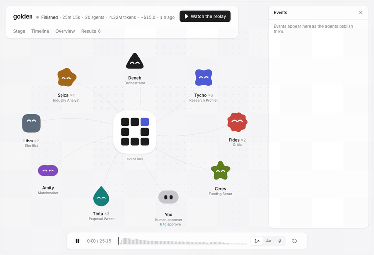
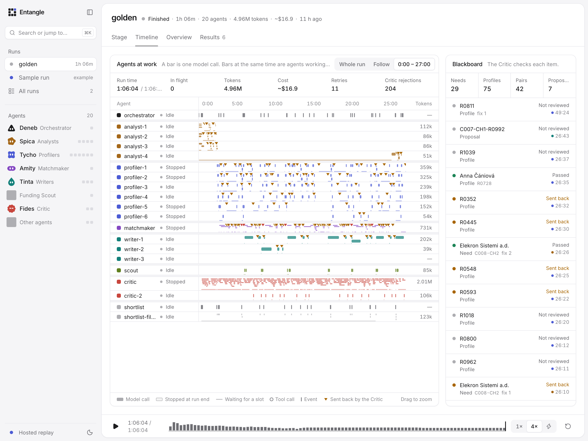

<p align="center">
  <picture>
    <source media="(prefers-color-scheme: dark)" srcset="docs/brand/entangle-lockup-animated-dark.svg">
    
  </picture>
</p>

# Entangle: the EINSTEIN matchmaker

**See it with no install:** [madebynikola.github.io/Entangle](https://madebynikola.github.io/Entangle/) opens the web app on the
committed reference run (`out/golden/`): the agents' Timeline, the pairs and the proposals with every source.

A team of Mozaik agents splits the EINSTEIN dataset (1,047 researchers, 153 companies, about 7 million tokens) and works on it
in parallel. It finds researcher–challenge pairs that fit a company's stated problem, says so when a challenge has no good match, and writes
an industrial PhD topic or a one-page joint project for each chosen pair. A Critic checks every claim against the record it cites,
and a person approves each pair before anyone is contacted.

Hackathon track 02 (EINSTEIN: Science-to-Business Matchmaker), JigJoy × NTP Novi Sad, 30–31 October 2026.

<p align="center">
  <picture>
    <source media="(prefers-color-scheme: dark)" srcset="docs/brand/entangle-stage-dark.gif">
    
  </picture>
</p>

<sub>The Stage tab replaying the reference run (<code>out/golden/</code>) in real time: its first half minute, then its last. Each face is a role, each bubble an event on the Mozaik bus.</sub>



<sub>The Timeline of a real 5-company run. One row per agent, one bar per model call. Bars that overlap are agents working at the same time.</sub>

**Contents:** [Try it](#try-it-no-keys-needed) · [Run it](#run-it-on-real-models) · [Architecture](#architecture) ·
[Concurrency](#how-the-agents-run-concurrently) · [The Critic](#where-the-critic-stepped-in) · [EINSTEIN](#how-this-plugs-into-einstein) ·
[Data](#responsible-use-of-data) · [Limits](#limits-and-next-steps) · [Repository](#repository)

## Try it, no keys needed

```sh
git clone https://github.com/madebynikola/Entangle.git && cd Entangle
npm install                      # Node 20 or newer
npm run replay -- out/golden     # the committed reference run in the web app
```

The app opens at http://localhost:4317 on the reference run. **Overview** tells what happened, **Timeline** replays the agents at work
(press play, or Space), and **Results** has the pairs and proposals with every source. The run folder holds the trace,
the results and every cited record, so the replay needs no `.env`, no API key and no dataset.

Run the whole team yourself on the mock model (fake latency, no keys, no cost):

```sh
npm run match -- --mock          # without data/raw/ it uses the 5-company test fixture
npm run replay                   # opens the newest finished run
```

A mock run plants one invented claim in a need, a profile and a proposal, so you can watch the Critic catch and send back each one.

## Run it on real models

1. **Dataset** (gitignored): `git clone https://github.com/jigjoy-ai/einstein-matchmaker-data data/raw`.
   Without it, every run uses the small fixture in `test/fixtures/` (5 companies, 30 researchers).
2. **Model access:** `cp .env.example .env`, then set one of these:
   - `ANTHROPIC_API_KEY=...` (OpenAI and Gemini keys work too, see [models](#models-budget-and-rate-limits)), or
   - `LOCAL_CLAUDE=1`: each model call runs as a headless Claude Code session (`claude -p`) on your own Claude login. No API key.
     Needs the `claude` CLI, logged in. `--local` does the same for one run.
   - Optional, `SUBQ=1` and `SUBQ_API_KEY=...`: the second Critic runs on [SubQ](https://docs.subq.ai/)'s `subq-snap-1.1`,
     a decision model that answers one yes/no question per claim. `SUBQ_MODEL=jev-latest` with `TYPESAFE_API_KEY` uses
     [Jev](https://typesafe.ai/blog/introducing-system-one-models-and-jev) instead. `--subq` does the same for one run.
   - Optional, `SCREEN=1`: the same decision model, with the same key, filters each shortlist before profiling. It answers
     one yes/no question per candidate in one call, and only the most likely to fit are profiled. `--screen` does the same for one run.
   - Optional, `OPENALEX_API_KEY=...` (free, from [openalex.org/settings/api](https://openalex.org/settings/api)): each proposal
     gets a **Prior work** section. Before a Writer starts, it asks [OpenAlex](https://openalex.org) for recent, cited works on the
     need's search terms, and the proposal may cite up to two of them by work id (`W4293154696`). Mock runs stay offline.
   - Nothing to set for the **Funding Scout**: the EU Funding & Tenders portal's search API is public (`apiKey=SEDIA`), and so is
     [CORDIS](https://cordis.europa.eu/projects)'s. Each proposal ends with up to three open or upcoming EU calls that fit the pair, and
     up to three EU-funded projects on the same problem, whose organisations are possible consortium partners. Mock runs use the calls and
     projects saved in `test/fixtures/`.
3. **Run:**

```sh
npm run match -- --companies 5   # the first 5 companies; --ids C006,C054 for chosen ones; --companies all for every one
```

The CLI prints one line per milestone (a company read, a pair chosen, a proposal accepted or sent back) and a summary at the end.
Everything lands in `out/<run-id>/`:

| File | What is in it |
| --- | --- |
| `trace.jsonl` | Every Mozaik event of the run, one JSON line each, tied to its agent, task and loop |
| `proposals/<id>.md` | The proposals the Critic accepted, each with the Funding Scout's EU calls and related EU projects at the end |
| `needs-human/<id>.md` | Proposals the Critic could not clear: a person decides |
| `pairs.json`, `results.json` | Needs, profiles, pairs, "no match" outcomes, proposals, verdicts and the EU calls and projects per chosen pair |
| `sources.json` | Every record a claim cites, OpenAlex works, EU calls and CORDIS projects included, so the run replays without the dataset or the network |
| `summary.json` | Counts, Critic statistics, failures, budget, and time, tokens and cost per task |

`npm run replay -- out/<run-id>` opens any run folder. `npm run dev` opens the app with live runs as they happen.

| Option | Default | What it does |
| --- | --- | --- |
| `--companies N \| all`, `--ids LIST` | 5 | Which companies to work on |
| `--analysts N`, `--profilers N`, `--writers N` | 4, 6, 3 | Agents per role |
| `--k N` | 4 | Researchers shortlisted per challenge |
| `--proposals N` | one per company | Most proposals in the run |
| `--mock`, `--local` | | Mock model, or local Claude Code sessions |
| `--subq`, `--screen` | | The second Critic, or the shortlist filter, on a decision model |

**Time and cost.** Our 5-company run on Sonnet 4.6 and Haiku 4.5 took 40 minutes on local Claude Code and used 3.5M tokens,
about $20 at API prices. It reached the default $20 budget during the last proposal reviews, so raise `BUDGET_USD` (and
`BUDGET_MINUTES`) in `.env` for more companies. `npm run match -- --help` lists every option and setting.

## Architecture



Every box with a dot is a Mozaik participant in one runtime (`@mozaik-ai/core` 4.1.0). Agents never call each other.
They read and write one shared blackboard and talk through events on one bus, where every participant sees every event.

| Role | Agents | Model | Takes | Puts on the blackboard |
| --- | --- | --- | --- | --- |
| Orchestrator | 1 | none | Progress events | Assignments, the pair chosen per company, the result |
| Industry Analyst | 4 | Haiku 4.5 | One company: profile, challenges, website, job ads, news | One need per challenge: triage (research, engineering service, not research) with the reason, an English academic restatement, 5–10 search terms, what the company brings, constraints |
| Shortlist | 1 | none (subq-snap with `SCREEN=1`) | Each need as it is posted | 4 candidates per need, by BM25 on the Analyst's search terms. People who left, or retired and do not consult, are skipped. With `SCREEN=1`, the decision model rates 8 and only the 4 most likely to fit stay |
| Research Profiler | 6 | Haiku 4.5 | One shortlisted researcher: profile, publications, projects, patents | A profile: expertise and industry facts, each backed by records, availability as timing only, and whether they can lead |
| Matchmaker | 1 | Sonnet 4.6 | One need and its candidate profiles | Pairs with a fit to this problem (0–1), why these two, the problem they solve and the risks; or "no good match" with the reason |
| Proposal Writer | 3 | Sonnet 4.6 | One chosen pair and its records, and recent OpenAlex works on the need (with `OPENALEX_API_KEY`) | The proposal, shaped like [the example PhD topic](docs/brief/example-industrial-phd-topic.md): problem, prior work, research questions, approach, plan, first six months, what each side brings, why this pair, risks, what is agreed up front |
| Critic, Critic 2 | 2 | Sonnet 4.6, Haiku 4.5 | Every artifact the moment it is posted | Verdicts; rejected claims sent back to their producer |
| Funding Scout | 1 | Haiku 4.5 | Each chosen pair, while its Writer writes, the [EU Funding & Tenders](https://ec.europa.eu/info/funding-tenders/opportunities/portal/) portal and [CORDIS](https://cordis.europa.eu/projects) | Up to 3 open or upcoming EU calls that fit the pair, each with why and what to check first, or "no call fits" with the reason; up to 3 EU projects on the same problem, with their coordinator and any partner from Serbia |

<table align="center">
  <tr>
    <td align="center"><br><b>Deneb</b><br><sub>Orchestrator</sub></td>
    <td align="center"><br><b>Spica</b><br><sub>Industry Analyst</sub></td>
    <td align="center"><br><b>Tycho</b><br><sub>Research Profiler</sub></td>
    <td align="center"><br><b>Amity</b><br><sub>Matchmaker</sub></td>
    <td align="center"><br><b>Tinta</b><br><sub>Proposal Writer</sub></td>
    <td align="center"><br><b>Fides</b><br><sub>Critic</sub></td>
    <td align="center"><br><b>You</b><br><sub>Human approver</sub></td>
  </tr>
</table>

<p align="center"><sub>The faces the web app gives each role, from the brand kit in <a href="design/"><code>design/</code></a>.</sub></p>

### Work starts when its input exists, not in stages

The Orchestrator hands out work as events arrive. It makes no model calls.

1. Every company goes to an Analyst at once: one Mozaik loop per company, spread over the Analysts.
2. Each need is shortlisted the moment it is posted, and its candidates go to the Profiler with the fewest open tasks.
   Profiling starts while other companies are still being read. A researcher is profiled once, however many needs pick them.
   Profiling is lazy: only shortlisted researchers, because reading all of them would cost about 8 million tokens.
3. When a need's candidates are profiled, the need goes to the Matchmaker. A "not research" need becomes a "no match" with no model call.
4. When every review of a company has ended, the Orchestrator picks that company's pair: its need, profile and pair must all have passed the Critic.
   The pair goes to the Writer with the fewest open tasks, while other companies are still in matching.
   Each company gets one proposal and each researcher one proposal per run, so the result covers many different people.
   The Funding Scout hears the same `orchestrator.decided` event and works on the pair beside the Writer. Its model writes a few
   queries in the EU's own words, the code searches the portal and CORDIS with them and the need's terms, and the model picks the
   calls that fit and the projects that worked on the same problem.
5. The Critic reviews every need, profile, pair and proposal as it lands, beside all of this.

### The shared blackboard

`MatchState` (`src/runtime/state.ts`) holds `needs`, `profiles`, `candidates`, `noMatches`, `proposals`, `verdicts`, `tasks` and `budget`,
keyed by dataset id. Every fact on it is a `Claim { text, sourceIds }` that cites dataset ids: `R0001`, `C001-CH1`, `SYN-PUB-00001`,
`SYN-PRJ-0001`, `SYN-PAT-001`, or a company page as `C001/job/2024-02-05/<title>`. A proposal's Prior work cites real OpenAlex
works as `W4293154696`. Producers announce each artifact with an
`artifact.posted` event. The web app and the trace read the same state.

### The Critic loop

Every artifact goes through the same three steps (`src/agents/critic/`):

1. **Code check, no model.** Each claim cites at least one source. Each cited id exists. Each cited record belongs to the artifact's
   researcher or company: by id, never by name. This catches same-name co-authors and company staff who share a researcher's name.
   An OpenAlex work id exists only if OpenAlex returned it in this run, so an invented paper fails here.
2. **Model check.** The reviewer reads the cited records and decides, claim by claim, whether the record says what the claim says.
   It gives the reason before the verdict. A re-posted artifact only has its changed claims checked again.
   Proposals get a **second reviewer** at the same time, on another model and in its own context. A claim passes only if both pass it,
   and each disagreement is logged as `critic.split`. A proposal's **free text** (research questions, approach, plan, reasoning) gets
   its own check too: each sentence that states as true what no claim or source states goes back as a `free-text` reject.
   See [docs/quality.md](docs/quality.md) for what a hand-check found and what this changed.
3. **Verdict.** Accept, or send the rejected claims back to the producer as a new task, with the reason for each.
   The producer fixes only those claims (cite a record that says it, narrow the claim, or remove it) and posts the artifact again.
   If it is still rejected after two send-backs, the Critic cuts the claims the fixes could not save from a need, profile or pair
   and keeps the rest (`critic.trimmed`). It drops the artifact only when a core claim failed: a need's restatement, a pair's problem,
   a profile's availability. A proposal gets the same cut. It goes to a person (`needs-human/`) when a core claim or a
   free-text sentence is still rejected; the core claims are its header and its last claim under "The problem" and "Why this pair".

Only accepted artifacts reach the result. A Writer never starts on a pair whose need, profile or pair is still in doubt.

### Models, budget and rate limits

Every model call goes through one `ResilientRunner` (`src/runtime/resilient-runner.ts`) around the model backend:

- at most 16 calls in flight over all providers (`MAX_IN_FLIGHT`), with a token bucket per provider for requests and input tokens per minute;
- a freed slot goes to the call furthest down the pipeline: writes and proposal reviews, then need reviews and their fixes, then matches
  and pair reviews, then profiles, then analyses; first come first served within one. So a company that is almost done does not wait
  behind the profiles of companies that just started. With local Claude Code, the slots are capped at its sessions, so calls wait here in that order;
- retries on 429, 5xx and network errors, with exponential backoff and jitter; a `retry-after` header wins, and a 429 pauses that whole provider;
- a budget for the run: tokens, dollars, wall clock and attempts per task (`BUDGET_TOKENS`, `BUDGET_USD`, `BUDGET_MINUTES`, `MAX_ATTEMPTS`).
  At the limit no new task starts. Running tasks get 10% more to finish, then their calls are refused too;
- no call for a task that has already settled (timed out, out of budget, or failed).

Each retry is a trace event, and each call records how long it waited. Models per role are in [`config/models.ts`](config/models.ts): the many parallel workers
run on Haiku 4.5, and the few calls that decide quality (Matchmaker, Writer, Critic) on Sonnet 4.6. The second Critic takes another
provider when a key for one is set, else Haiku 4.5. With keys for more providers, the workers spread over all of them to share
the rate limits. `MODEL_<ROLE>` in `.env` pins one role, for example `MODEL_CRITIC=claude-haiku-4-5`. The backends are Mozaik's
own (Anthropic, OpenAI, Gemini), local Claude Code (`LOCAL_CLAUDE=1`, 6 sessions at once by default), and the mock. Calls to a
decision model (subq-snap, Jev) go to its own API; they write no text, so only the second Critic (`SUBQ=1`) and the shortlist
filter (`SCREEN=1`) use one.

## How the agents run concurrently

- **Each task is its own Mozaik loop.** `runTask` starts a `runLoop`, which does not wait, with a fresh context. One agent can have
  several loops open, and every role works at the same time. The tracker ties each loop to its task through the context id.
- **Nobody waits for a stage.** The Orchestrator, the Shortlist and the Critic react to events (`artifact.posted`, `shortlist.ready`,
  `critic.sent_back`), so analysis, profiling, matching, writing and review overlap.
- **Only the limits slow it down:** the runner's 16 slots, the provider rate limits, or the 6 local Claude Code sessions.

**Numbers from a real run:** 5 companies on 30 October, Sonnet 4.6 and Haiku 4.5 on the local Claude Code backend
(6 sessions at once), 40 minutes, 320 model calls by 16 agents.

| Measure | Value |
| --- | --- |
| Model calls open at once (running, or waiting for a slot) | 46 on average, 71 at the peak |
| Model calls the runner let out at once | 13.9 on average, 16 (its cap) at the peak |
| Claude Code sessions busy | all 6 for 90% of the run |
| Model time against wall time | 3 h 52 min of model calls in 40 min, so 5.8 calls at once on average |
| Roles calling a model at the same moment | up to 4; two or more for 70% of the run |

| Role | First call | Last call | Overlaps with |
| --- | --- | --- | --- |
| Industry Analysts | 0:00 | 30:21 | everyone: after their first pass they fix needs the Critic sent back |
| Research Profilers | 0:50 | 30:12 | Analysts still reading, the Matchmaker, the Critic |
| Critic | 0:50 | 40:08 | the whole run, starting 50 seconds in |
| Matchmaker | 12:57 | 33:13 | Profilers still profiling, Writers already writing |
| Proposal Writers | 32:41 | 39:00 | the Matchmaker and the Critic |

On the API, the same runner lets 16 calls run at once instead of 6.

**Check it yourself.** Open the Timeline (`npm run replay -- out/golden`): each bar is one model call, and a thin line before a bar
is time spent waiting for a slot. Or count from the trace; this prints the second row of the table above:

```sh
node -e '
const records = require("fs").readFileSync(process.argv[1], "utf8").trim().split("\n").map(JSON.parse)
const sent = {}, edges = []
for (const r of records) {
  if (r.kind === "inference.dispatched") sent[r.loopId] = r.ms
  if (r.kind === "inference.completed" && r.loopId in sent) edges.push([sent[r.loopId], 1], [r.ms, -1])
}
edges.sort((a, b) => a[0] - b[0] || a[1] - b[1])
let now = 0, peak = 0, area = 0, last = 0
for (const [ms, step] of edges) { area += now * (ms - last); last = ms; now += step; peak = Math.max(peak, now) }
console.log({ calls: edges.length / 2, peakInFlight: peak, averageInFlight: +(area / last).toFixed(1) })
' out/golden/trace.jsonl
```

Each line of `trace.jsonl` has `ms` (since the start), `kind`, `agent`, `taskId`, `loopId` and `model`. `inference.dispatched`
is when the runner let a call out past the rate limits; the time before it is a wait.

## Where the Critic stepped in

One case from the same run. At 34:43, `writer-1` posted proposal `C003-CH1-R0365`: AutomVoj (C003), whose conveyor frames crack
at the welds after 18 months in cold stores, with Bojan Erić (R0365), who works on low-temperature fatigue of welded steel.
Both reviewers checked its 29 claims at the same time, the Critic on Sonnet 4.6 and the second reviewer on Haiku 4.5.
At 37:28 the Critic sent 7 claims back to `writer-1`, among them:

| Claim | Cites | Why it was rejected |
| --- | --- | --- |
| "Two failed frame sections are retained in storage and are available for destructive testing." | C003-CH1 | The challenge only says "we still have two of the failed sections in storage". Nothing says they are available for destructive testing. |
| "The company requires the outcome to be a change to welding procedure, filler material, or joint design…" | C003-CH1 | The company wrote "a good outcome would be…": a wish, not a requirement. |
| "In-house fabrication shop with MIG/MAG welding capability to produce replicated test specimens…" | C003, a C003 job ad | Both confirm the shop and MIG/MAG welding, but not that it can make test specimens. |

`writer-1` narrowed each claim to what its record says ("Two failed frame sections in storage. [C003-CH1]") and posted the
proposal again at 37:54. Only the 7 changed claims were checked again, and both reviewers accepted it at 38:08.

Across the run the Critic made 177 reviews, sent 81 artifacts back with 181 rejected claims, dropped 3, and logged 5 splits
where the two reviewers disagreed. In the Timeline each send-back is an orange mark on the producer's lane.

Find every send-back in a trace with `grep '"critic.sent_back"' out/golden/trace.jsonl`, or in the Blackboard panel next to the Timeline.

## Proposals

The reference run's accepted proposals are in [`out/golden/proposals/`](out/golden/proposals/), one Markdown file per pair,
with the source ids after every claim. Proposals the Critic could not clear are in `out/golden/needs-human/`. Each one follows
[the example PhD topic](docs/brief/example-industrial-phd-topic.md): the company's problem in its own facts, two or three research
questions with how each is measured, the approach, a plan by period, the first six months step by step, what each side brings,
why this pair and not another, risks, and what both sides agree up front (data, publication, ethics where it applies).
In the Results tab, each cited id opens its source record.

## How this plugs into EINSTEIN

[EINSTEIN](https://cordis.europa.eu/project/id/101136377) is a Horizon Europe project (2024–2028) led by the University of Novi Sad,
with the Science and Technology Park Novi Sad, the Vojvodina ICT Cluster and partner universities in Linz, Wageningen and Copenhagen.
It aims to make the university a hub for regional development and technology transfer. Entangle is a tool for the people in that
network who connect a faculty with a company. It does the reading, so they can spend their time on the introductions.

- **Who uses it:** EINSTEIN coordinators and technology-transfer staff at UNS and NTP. They own the relationships; Entangle prepares
  the meeting. Its Results screen is their worklist: each pair with its evidence, each proposal with its sources, approve or reject.
- **What it reads:** the agents work on ids, so only the data layer (`src/data/`) changes for real data. On the company side, NTP
  and cluster members fill in a short challenge form with the fields the dataset already has (challenges, products, tech, plans,
  R&D capacity), plus their public website and job ads. On the research side: publications from OpenAlex (UNS is `I170726198`),
  ORCID records by the iDs researchers give, and projects from CORDIS. Never a search for a person by name.
- **When it runs:** a batch run for each new cohort of NTP members or each open call, and on request when one company brings a problem.
- **What comes out, in EINSTEIN's own instruments:** industrial PhD topics for the doctoral schools, one-page joint projects for
  the Innovation Fund or Horizon Europe calls, and consulting or contract research where a researcher says that is what they want.
  A challenge triaged as an engineering service points to a student project or training, which fits EINSTEIN's upskilling work.
  A challenge with no research behind it gets a plain "not a research problem", so nobody's time is spent on a forced match.
- **What happens next:** the coordinator approves a pair, and EINSTEIN makes a warm introduction with the proposal as the agenda.
  Whether the meeting happened and what came of it goes back as a label, so later runs learn which pairs lead somewhere.

### EINSTEIN Stars

EINSTEIN Stars works with startups and companies at NTP. For them, Entangle would be the step that turns "we have a problem"
into "here is who at the university works on it":

- **At entry.** A company that joins Stars fills in its challenges once. A run on that company alone
  (`npm run match -- --ids C054`) reads its challenges, website and job ads next to the whole university. It returns a triage
  for each challenge, the candidate pairs with their evidence, and one proposal the company can take to a first meeting.
- **The triage routes each challenge to the right help.** A research problem goes to a faculty. An engineering service
  points to a student project or a consultancy. A challenge that is not research at all (a funding round, hiring, a licence)
  gets a plain answer that research cannot solve it, so the programme can offer its own business support instead.
- **Sized for small teams.** Each proposal says what each side brings (data, a lab, staff time) and the company's constraints.
  It is a one-page joint project or an industrial PhD topic, and a PhD only when the researcher can supervise and the problem
  is research. A startup can start with the one-page project.
- **During the programme.** The company runs it again when its challenges change. The coordinator's approvals and
  meeting outcomes become the company's record of collaborations, which the programme can report on.

## Responsible use of data

- **Only the provided dataset, and published work by topic.** Every researcher, company and record is synthetic, but the names look
  real and the faculties are real, so we treat it as personal data. No agent searches the web or a real API for a person: a synthetic
  name would match real people. The one real API, OpenAlex, is searched with a need's search terms only, and its authors are never
  read or kept. A proposal cites a work for what it reports, and the Critic rejects a claim that gives it to the researcher or the company.
  The Funding Scout searches the EU Funding & Tenders portal and CORDIS with topic words only (its own queries, the need's search
  terms and the sector), never a name. CORDIS projects list organisations, and the Scout keeps no person from them. Every fact it shows
  (title, programme, dates, grant, coordinator, link) is the source's own: code keeps only what the search returned, and only calls with
  a deadline still ahead. The model only picks among them and says why, and that text is marked as not reviewed.
- **Pairs, not people.** The system ranks researcher–challenge pairs by fit to one stated problem, and compares fit only within a challenge.
  It never outputs a score, a list or a ranking of people. The Matchmaker's prompt forbids seniority, productivity, publication counts
  and prestige as reasons. Search scores a researcher by the mean of their 3 best-matching records, not the sum, so a long publication
  list adds nothing by itself. A shortlist means "candidates for this problem". The shortlist filter (`SCREEN=1`) asks the same
  question: do this researcher's records fit this challenge.
- **Every claim has a source.** Each claim cites dataset ids, and the Critic checks by code that each cited record exists and belongs to
  that researcher or company. Identity is by id only. The four duplicate profiles are merged on load, and two people with one name stay two.
- **Personal details stay out.** Reasons for limited availability (parental leave, children, health) are removed when the data loads;
  only the timing stays ("on leave until September 2026"). Email addresses are removed from company pages before an agent reads them.
  Private notes are used as constraints, never quoted. People who left are never proposed; emeritus professors can consult but are never
  proposed to lead or supervise. Proposals that use patient or clinical data name ethics approval and data protection (GDPR and the
  Serbian personal data law) as preconditions.
- **A person approves before outreach.** Nothing is sent to anyone. A coordinator reads each proposal with its sources in Results,
  and approves or rejects the pair (stored in `out/<run>/approvals.json`). Only an approved pair is introduced, through EINSTEIN.
  Proposals the Critic could not clear wait in `needs-human/` for the same person.

The traps the dataset hides (duplicates, shared names, stale profiles, non-research challenges, personal data) and how we handle
each one are in [`docs/dataset.md`](docs/dataset.md).

## Limits and next steps

**Limits**

- The data is synthetic. Real use needs real profiles, and the consent of the people in them.
- Retrieval is BM25 on the Analyst's search terms. A researcher who describes the same work in other words can be missed,
  and only shortlisted researchers (4 per need) are profiled.
- The Critic checks that each claim is supported, not that the proposal is good. Quality comes from the prompts and the
  Matchmaker's criteria; a person still reads every proposal.
- One proposal per company and per researcher per run, by design.
- Mozaik 4.1.0 cannot cancel a loop. A task stopped by the budget is failed and its loop is dropped, not killed.
- The local Claude Code backend runs 6 sessions at once, so a run on it takes longer than on the API.

**Next steps**

- Reverse search: a company describes a problem and the system finds researchers.
- The Innovation Fund of Serbia in the Funding Scout. It has no API, so proposals only link to its calls page for now.
- Multilingual embeddings fused with BM25, for wording and language gaps (26 companies write in Serbian).
- Approvals and rejections fed back into matching.
- Adapters for real profiles by id: ORCID and OpenAlex authors, once researchers give their own iDs. A name search is never safe:
  a synthetic name matches real people. OpenAlex works by topic are already in, as Prior work, and open EU calls and CORDIS projects
  by topic, through the Funding Scout. Lens and Espacenet (patents) need a registered token.

## Repository

| Path | What is there |
| --- | --- |
| `src/agents/` | One folder per role: `orchestrator`, `analyst`, `profiler`, `matchmaker`, `writer`, `critic`, `scout` |
| `src/runtime/` | The Mozaik runtime, the `MatchState` blackboard, tasks, the `ResilientRunner`, the local Claude Code and mock runners |
| `src/data/` | Dataset loading, clean-up, duplicate merge, BM25 search, the agents' data tools, and the OpenAlex, EU calls and CORDIS clients. No model calls |
| `src/trace/` | The trace observer that writes `trace.jsonl` |
| `src/server/`, `web/` | The local server and the web app (see [`web/README.md`](web/README.md)) |
| `config/models.ts` | Models per role, rate limits, retries and budget |
| `docs/` | [Dataset notes](docs/dataset.md), the track brief, the architecture diagram |
| `out/golden/` | The committed reference run |

Checks: `npm run typecheck`, and `node --import tsx --test src/data/*.test.ts test/*.test.ts src/agents/*/*.test.ts`.
